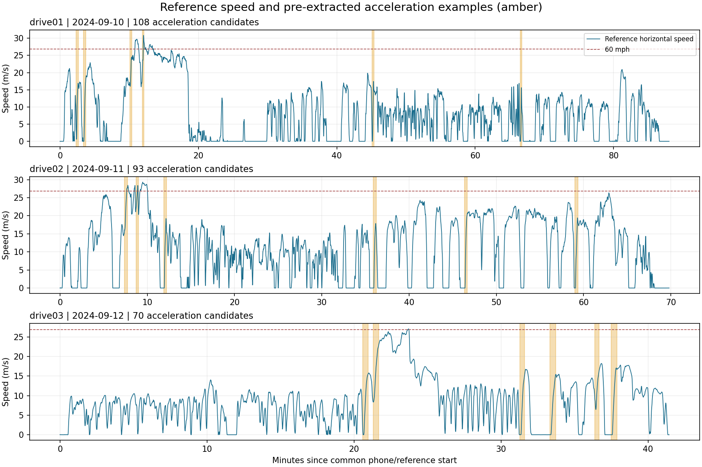

# GEDVM Smartphone GNSS Vehicle Manoeuvre Dataset

Raw Google Pixel 5 and Pixel 7 Pro GNSS measurements with phone-specific,
post-processed NovAtel PwrPak7 GNSS/INS reference trajectories from three driving
sessions in Calgary, Canada, collected on 10–12 September 2024.

This data release accompanies:

Yang Jiang, Yan Zhang, Zhitao Lyu, Zelin Zhou, Hongzhou Yang and Yang Gao,
**Accurate Vehicle Maneuver Analysis Using Smartphone GNSS Carrier-Phase Measurements**,
IEEE Transactions on Intelligent Transportation Systems, 26(11), 18611–18621, 2025.
[Paper DOI](https://doi.org/10.1109/TITS.2025.3594956).

[Data format](docs/DATA_FORMAT.md) ·
[Time alignment](docs/TIME_ALIGNMENT.md) · [Selection and limitations](docs/SELECTION.md)

## Contents

- Six complete, unmodified source phone log ZIPs: two phones per drive.
- Six corresponding 1 Hz reference tables in CSV, including ENU velocity, acceleration and attitude.
- Receiver-clock epoch indexes and source/output SHA-256 checksums.
- **271 automatically screened acceleration candidates**, shared by the two phones in each drive.
- **18 pre-extracted event pairs** in three quick-start ZIPs: both phones' Raw measurements and individual reference tables.
- Python 3.10+ helpers using only the standard library; no MATLAB or proprietary software is required to read this release.

| Drive | Date | Common phone/reference span (min) | Acceleration candidates | Maximum common-reference horizontal speed (m/s) |
|---|---|---:|---:|---:|
| drive01 | 2024-09-10 | 88.0 | 108 | 30.84 |
| drive02 | 2024-09-11 | 69.8 | 93 | 29.32 |
| drive03 | 2024-09-12 | 41.4 | 70 | 27.04 |

The common spans describe time-envelope overlap, not a guarantee of usable carrier phase at every epoch.
Both phones observe the same drive: their copies of an event are **paired observations, not independent trials**.



## Quick start

Clone or download this repository:

```sh
git clone https://github.com/YangRiverJiang/gedvm_dataset.git
cd gedvm_dataset
```

1. Unzip `data/examples/drive01_acceleration_examples.zip`. Every event directory contains
   two `*_raw.txt` files, their two `*_reference.csv` tables and `event.json`.
2. Use `metadata/acceleration_events.csv` to find other events and their GPS-week/seconds-of-week boundaries.
3. Extract any listed event, including both phones:

```sh
python tools/extract_event.py drive01_A001 --output extracted
```

4. Check the complete release:

```sh
python tools/verify_dataset.py
```

For full sessions, unzip the corresponding `data/raw/*.zip` and use the matching
`data/reference/*.csv`, as listed in `metadata/sessions.csv`. Original source filenames
and checksums are retained in `metadata/sessions.json`.

## Scope and important limitations

These are ordinary driving sessions, **not dedicated or certified 0–60 mph trials**.
The new acceleration catalog is reference-derived screening, not the original paper's
event labels or a recreation of its event counts. Event context windows can overlap.
The full phone sessions are retained so users can apply their own event definitions.

The phone GNSS epochs and available reference exports are approximately 1 Hz.
No phone IMU sample records were found in the released logs. Sensor format comments
in a header do not mean that sensor samples were recorded.

The references are smoothed GNSS/INS solutions exported from Inertial Explorer
8.90.6611, as recorded by the actual file headers. Phone-specific lever-arm settings
are included in `metadata/reference_*.txt`; preserve each phone's matching reference.
The original PwrPak7 receiver binaries and higher-rate reference solutions are not
included. Solution quality codes are preserved but not interpreted as a universal
accuracy guarantee; no per-epoch velocity uncertainty is available in these exports.

The paper's trajectory-wide factor graph estimates are not included here and should
not be treated as a real-time smartphone timing benchmark.

## Publication and privacy

This release deliberately retains **exact vehicle coordinates and recording times**,
including phone `Fix` records. The trajectories are not anonymized geographically.
No driver names, ages, photographs, vehicle registrations, paper drafts or emails are
included. Raw logs also retain startup clock anomalies, fused/network location fixes
and device status records; the extracted examples contain only Raw measurement rows.
See [selection notes](docs/SELECTION.md).

## License and citation

The dataset, documentation and included helper scripts are released under
[Creative Commons Attribution 4.0 International](https://creativecommons.org/licenses/by/4.0/)
([full text](LICENSE)). Attribute the dataset to the authors listed above, cite the
paper, link to this license, and identify changes. The paper itself is not included
or relicensed by this data release. See [CITATION.cff](CITATION.cff) and [citation.bib](citation.bib).
